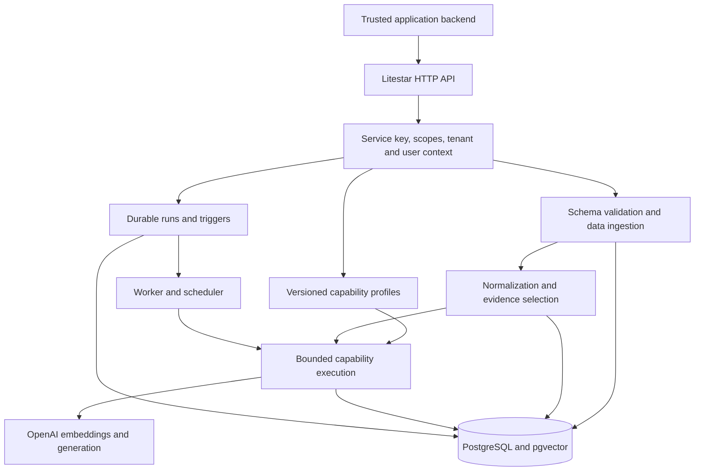

# PAIagent

**AI backend for application data, document search, and evidence-based analysis.**

PAIagent connects structured records, event history, and documents to a common evidence layer. Applications use its HTTP API to search information, ask questions, generate summaries, extract structured data, analyze activity, and produce recommendations. Versioned profiles define what each operation can read, how it should respond, and which execution budgets apply.

Built with **Python, Litestar, PostgreSQL, pgvector, SQLAlchemy, LangGraph, and OpenAI**. The service includes tenant and user isolation, scoped service keys, durable background execution, scheduled and change-driven runs, opt-in memory, and feedback.

[Developer guide](documentation/README.md) · [Installation](documentation/operations.md) · [HTTP quickstart](documentation/quickstart.md) · [API reference](documentation/reference.md) · [OpenAPI](documentation/openapi.json)

## What it does

| Capability | Behavior |
| --- | --- |
| Search | Retrieve relevant evidence from selected application data and normalized file text. Document retrieval also supports vector, full-text, and hybrid search. |
| Query | Answer questions using selected evidence and return source references. Document question answering uses a LangGraph retrieval and validation workflow. |
| Summarize | Build summaries from selected records, events, or supported text inputs. |
| Extract | Produce structured output validated against a declared JSON Schema. |
| Analyze | Compute declared metrics in Python and ground generated commentary in those results. |
| Recommend | Generate recommendations from selected evidence, profile constraints, and explicitly enabled personalization. |

Each capability runs through a versioned analysis profile. Profiles select collections, schema versions, fields, filters, periods, output requirements, and limits on records, context, model calls, tokens, and execution time. Results carry source references, coverage, limitations, and freshness information so clients can distinguish sufficient evidence from partial or insufficient data.

### Data ingestion and retrieval

- Register sources and collections with immutable JSON Schemas and semantic field mappings.
- Deliver record snapshots and independent events with idempotent replay, version conflict handling, import tracking, and reconciliation.
- Attach TXT, Markdown, text-based PDF, and EPUB files; import CSV using explicit field mappings. File normalization retains location metadata for evidence references.
- Search indexed documents with pgvector cosine similarity, PostgreSQL full-text retrieval, or Reciprocal Rank Fusion of both rankings.
- Track data coverage and erase object, source, or user content with fences that prevent accidental replay of erased identities.

### Execution and personalization

- Run profiles synchronously or submit durable jobs with idempotency keys.
- Process jobs through a PostgreSQL-backed worker with leases, bounded retries, cancellation, and saved results.
- Configure scheduled and change-driven triggers; retrieve run status and results through polling.
- Manage opt-in memory, preferences, personalization settings, and result feedback through scoped APIs.
- Keep business data isolated by tenant and user, with additional API scopes and optional source restrictions.

## Architecture



The API and worker run as separate processes over the same database. PostgreSQL stores application data, document chunks and vectors, profiles, jobs, results, memory, and feedback. The worker also runs the scheduler; Redis and a separate message broker are not required.

LangGraph orchestrates document question answering and knowledge workflows. Data validation, authorization, retrieval, persistence, and capability execution remain ordinary Python services with explicit boundaries.

Service keys belong on a trusted backend. That backend authenticates its users and supplies `X-User-ID`; PAIagent resolves the tenant and grants from the bearer key. Raw service keys are shown once at issuance, and only their hashes are stored.

## Run locally

Prerequisites: Python, PostgreSQL with the **pgvector server extension**, and an OpenAI API key with access to the configured models. The [installation guide](documentation/operations.md) includes database provisioning, extension setup, tenant creation, and scoped key issuance.

```sh
git clone https://github.com/iow34/PAIagent.git
cd PAIagent
python3 -m venv .venv
.venv/bin/python -m pip install -r requirements.txt
cp .env.example .env
```

For an existing checkout, preserve your current `.env`. Configure `DATABASE_URL` and `OPENAI_API_KEY` locally, then apply migrations to the provisioned database:

```sh
.venv/bin/alembic upgrade head
.venv/bin/uvicorn app.asgi:create_app --factory --host 127.0.0.1 --port 8000
```

In another terminal, start the worker with the same environment:

```sh
.venv/bin/python -m app.jobs.worker --concurrency 4 --poll-seconds 1
```

Once the API is running:

| URL | Purpose |
| --- | --- |
| `http://127.0.0.1:8000/health` | Process liveness |
| `http://127.0.0.1:8000/developer/` | Developer guide and downloadable examples |
| `http://127.0.0.1:8000/schema` | Interactive API documentation |
| `http://127.0.0.1:8000/schema/openapi.json` | Live OpenAPI schema |

Embeddings use `text-embedding-3-small` with 1,536 dimensions. Set `OPENAI_GENERATION_MODEL` if you need a different generation model accessible to your account. Provider timeouts and retries are configurable in the environment.

## Try an integration

After [creating a tenant and issuing a scoped service key](documentation/operations.md), set the client environment:

```sh
export PAIAGENT_URL=http://127.0.0.1:8000
export PAIAGENT_USER_ID=demo-user
# Set PAIAGENT_SERVICE_KEY securely to the issued service key.
.venv/bin/python documentation/examples/quickstart.py
```

The standalone HTTP client registers tasks, books, and learning-session collections, validates and delivers sample data, attaches a Markdown file, creates a profile, submits an idempotent run, polls its result, and configures triggers. It imports no server services. The default search example uses lexical evidence without model calls; generation capabilities use your configured provider and consume tokens.

```sh
.venv/bin/python documentation/examples/quickstart.py --capability summarize
.venv/bin/python documentation/examples/quickstart.py --capability extract
.venv/bin/python documentation/examples/quickstart.py --domain books --capability search
.venv/bin/python documentation/examples/quickstart.py --domain learning_sessions --capability analyze
```

Domain bindings are declarations of schemas, field mappings, and profiles. Switching these examples does not require changes to server code. The [quickstart guide](documentation/quickstart.md) explains result inspection, trigger behavior, and demo cleanup.

## Repository layout

| Path | Responsibility |
| --- | --- |
| `app/api/` | HTTP controllers and request boundaries |
| `app/security/` | Authentication, access context, and scope checks |
| `app/integration/` | Integration contract, schemas, and client fixtures |
| `app/ingestion/`, `app/normalization/` | Parsing, chunking, file extraction, and CSV mappings |
| `app/capabilities/`, `app/orchestration/` | Profile execution and LangGraph workflows |
| `app/services/`, `app/repositories/` | Application services and database queries |
| `app/jobs/` | Durable worker, leases, and scheduling |
| `app/personalization/` | Memory and personalization rules |
| `app/db/` | SQLAlchemy models and Alembic migrations |
| `documentation/` | Published guides, OpenAPI, contracts, and runnable clients |
| `tests/` | Unit, HTTP, migration, and PostgreSQL integration tests |

## Verification

Check that exported documentation matches the application:

```sh
.venv/bin/python -m app.integration.export_documentation --check
```

Run the full suite with a disposable PostgreSQL cluster:

```sh
.venv/bin/python tests/run_postgres_tests.py --all
```

The runner requires local PostgreSQL server tools and a matching pgvector installation. It creates and removes its own temporary cluster. Tests use fake AI providers and include HTTP onboarding, tenant/source boundaries, ingestion, retrieval, jobs, memory, and migrations; they do not measure live model quality or production throughput.

For checks without PostgreSQL:

```sh
.venv/bin/python -m unittest discover -s tests -p 'test_*.py'
```

Database-dependent tests are skipped unless a test database is configured. See [operations](documentation/operations.md) for the complete verification workflow.

## Integration and deployment notes

The API provides backend integration; client applications own end-user authentication and presentation. PDF ingestion reads the text layer, and EPUB ingestion reads spine text. OCR and visual layout extraction are not included. Background result delivery uses polling.

Deployments provide TLS, process supervision, backups, monitoring, and their own retention policy. Content remains until explicit erasure; `/health` checks process liveness. Consult [client behavior](documentation/client-behavior.md) for result semantics, execution limits, and lifecycle rules.
